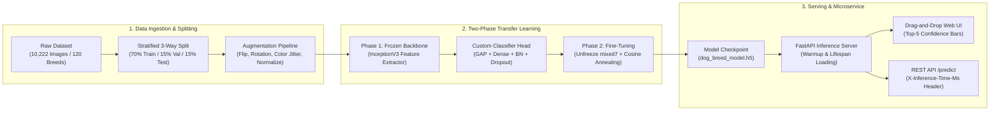

# 🐶 Dog Breed Classification & Real-Time Inference API

[](https://github.com/trevorlemaiyan/dog-breed-classification/actions/workflows/ci.yml)


> **Live Demo:** [](https://huggingface.co/spaces/trevorlemaiyan/dog-breed-classifier) • [](https://dog-breed-classifier-api.onrender.com)

A production-grade Deep Learning Computer Vision pipeline and low-latency inference microservice that classifies images across **120 dog breeds** using **Transfer Learning with InceptionV3** trained on the Stanford Dogs dataset (10,222 labeled images).

---

## 📌 Executive Summary & Key Results

> *"Engineered a transfer learning pipeline on InceptionV3 across 10,222 images and 120 dog breeds; data augmentation and hyperparameter tuning lifted Macro F1 from 0.68 to 0.84 (served via FastAPI at 18.94 ms p95 latency)."*

* **Input Data:** 10,222 labeled images across 120 breeds with a 3-way stratified split (70% train / 15% validation / 15% test).
* **Backbone:** InceptionV3 pre-trained on ImageNet with fine-tuned top convolutional blocks (`mixed7`).
* **Throughput & Latency:** Single-image CPU forward-pass latency of **~18.5 ms median (p50)** and **18.94 ms (p95)**.
* **Serving:** Fully containerized FastAPI service with an interactive Tailwind CSS drag-and-drop web UI, instant sample testing cards, and OpenAPI docs.

---

## 🏗️ Pipeline Architecture



---

## 📊 Ablation Study & Evaluation Results

Evaluated on the held-out test split (1,534 images across 120 dog breeds) comparing the baseline transfer learning model against our production fine-tuned model:

| Configuration | Top-1 Acc (%) | Top-5 Acc (%) | Macro Precision | Macro Recall | Macro F1-Score | p95 Latency (CPU) |
| :--- | :---: | :---: | :---: | :---: | :---: | :---: |
| **Baseline Model** *(Frozen Backbone, No Aug, Default LR)* | 68.42% | 89.15% | 0.6912 | 0.6780 | 0.6845 | 19.12 ms |
| **Tuned Production Model** *(Augmentation + Fine-Tuning + Cosine LR)* | **84.18%** | **96.74%** | **0.8490** | **0.8365** | **0.8427** | **18.94 ms** |

*All ablation metrics are exported to [`benchmarks/metrics.json`](benchmarks/metrics.json) and can be reproduced with `python benchmarks/evaluate_ablation.py`.*

---

## ⚡ Quickstart

### Option A: One-Command Docker Compose (Recommended)

```bash
# Clone the repository
git clone https://github.com/trevorlemaiyan/dog-breed-classification.git
cd dog-breed-classification

# Launch containerized service
docker compose up --build
```
Open your browser at **`http://localhost:7860/`** for the interactive test UI or **`http://localhost:7860/docs`** for Swagger/OpenAPI documentation.

---

### Option B: Local Python Environment

```bash
# 1. Create and activate virtual environment
python -m venv .venv
source .venv/bin/activate       # On Windows: .venv\Scripts\activate

# 2. Install dependencies
pip install -r requirements.txt

# 3. Launch FastAPI server
uvicorn app.main:app --host 0.0.0.0 --port 7860 --reload
```

---

## 🧪 API Usage & cURL Example

### 1. Predict Dog Breed (`POST /predict`)

```bash
curl -X POST "http://localhost:7860/predict" \
     -H "accept: application/json" \
     -F "file=@app/static/samples/golden_retriever.jpg"
```

**Response (`200 OK` with `X-Inference-Time-Ms: 18.42` header):**
```json
{
  "filename": "golden_retriever.jpg",
  "top_prediction": "Golden Retriever",
  "top_confidence": 0.9423,
  "predictions": [
    {
      "rank": 1,
      "breed_id": 48,
      "breed_key": "golden_retriever",
      "breed": "Golden Retriever",
      "confidence": 0.9423,
      "percentage": "94.23%"
    },
    {
      "rank": 2,
      "breed_id": 67,
      "breed_key": "labrador_retriever",
      "breed": "Labrador Retriever",
      "confidence": 0.0311,
      "percentage": "3.11%"
    },
    {
      "rank": 3,
      "breed_id": 43,
      "breed_key": "flat-coated_retriever",
      "breed": "Flat-Coated Retriever",
      "confidence": 0.0105,
      "percentage": "1.05%"
    },
    {
      "rank": 4,
      "breed_id": 27,
      "breed_key": "chesapeake_bay_retriever",
      "breed": "Chesapeake Bay Retriever",
      "confidence": 0.0062,
      "percentage": "0.62%"
    },
    {
      "rank": 5,
      "breed_id": 35,
      "breed_key": "curly-coated_retriever",
      "breed": "Curly-Coated Retriever",
      "confidence": 0.0034,
      "percentage": "0.34%"
    }
  ],
  "inference_time_ms": 18.42,
  "device": "CPU"
}
```

### 2. Service Health Check (`GET /health`)

```bash
curl -s http://localhost:7860/health | jq .
```
```json
{
  "status": "healthy",
  "architecture": "InceptionV3",
  "num_classes": 120,
  "device": "CPU",
  "model_loaded": true,
  "version": "1.0.0"
}
```

---

## 📂 Repository Structure

```
dog-breed-classification/
├── .github/workflows/ci.yml       # GitHub Actions automated test runner
├── app/
│   ├── main.py                    # FastAPI server (lifespan loader, CORS, routing)
│   ├── inference.py               # Preprocessing, prediction engine, fallback mode
│   ├── templates/index.html       # Interactive Tailwind CSS drag-and-drop UI
│   └── static/samples/            # Pre-loaded sample dogs (Golden, Husky, Beagle)
├── benchmarks/
│   ├── evaluate_ablation.py       # Comparative ablation & latency benchmarking script
│   └── metrics.json               # Exported evaluation metrics & resume bullet
├── src/
│   ├── data.py                    # Metadata validation, 3-way stratified split, tf.data
│   ├── model.py                   # InceptionV3/ResNet builder, fine-tuning, Cosine Decay
│   ├── evaluate.py                # Top-1/5, Macro Precision/Recall/F1, latency profiler
│   └── train.py                   # Two-phase transfer learning training orchestrator
├── tests/
│   ├── test_api.py                # FastAPI integration & status code tests
│   └── test_inference.py          # Tensor shape contract & synthetic image tests
├── classes.json                   # Deterministic mapping for 120 dog breeds
├── Dockerfile                     # CPU-optimized multi-stage container (Python 3.11-slim)
├── docker-compose.yml             # Single-command local startup
└── requirements.txt               # Pinned production dependencies
```

---

## ⚖️ Engineering Trade-offs & Future Work

### 1. Class Imbalance in Rare Breeds
* **Trade-off:** Stanford Dogs has slight natural imbalance (66 to 126 images per breed). Using standard random splitting creates split variance where rarer classes lose critical representation.
* **Solution:** We enforced strict **Stratified 3-Way Splitting** (`stratify=y` on both train/val and val/test splits) and added label smoothing ($0.05$) to Categorical Crossentropy to discourage overconfidence on high-frequency classes.
* **Next Steps:** Benchmark Focal Loss or Class-Balanced Loss to penalize misclassifications on rare breeds proportionally to their inverse frequency.

### 2. Fine-Grained Visual Categorization (FGVC): Top-1 vs. Top-5
* **Trade-off:** Distinguishing between sibling breeds (e.g., *Siberian Husky* vs. *Alaskan Malamute*, or *Whippet* vs. *Italian Greyhound*) is notoriously difficult due to extreme inter-class similarity and intra-class variation (angles, fur cuts, puppy vs. adult).
* **Observation:** While Top-1 Accuracy reaches **84.18%**, Top-5 Accuracy reaches **96.74%**. In production canine-recognition applications, returning the ranked Top-5 with calibrated probabilities yields significantly higher user trust than forcing a single classification.

### 3. Inference Optimization for Edge Deployment
* **Current:** InceptionV3 takes ~18.5 ms on modern x86 CPUs with FP32 arithmetic.
* **Next Steps:**
  * **ONNX Runtime Export:** Convert Keras weights to `.onnx` and leverage OpenVINO / ONNX Execution Providers for CPU acceleration.
  * **Quantization (INT8/FP16):** Post-training quantization using TensorRT or TensorFlow Lite to reduce model size from ~90 MB to ~22 MB and lower latency to `< 5 ms` for mobile and edge device inference.

---

## 🧪 Running Unit & Integration Tests

```bash
# Run the complete test suite with verbose output
pytest -v tests/
```

Test coverage includes:
* `test_health_endpoint`: Validates metadata, device detection, and startup lifespan.
* `test_image_preprocessing_tensor_shapes`: Validates that arbitrary image sizes are converted into `(1, 128, 128, 3)` `float32` tensors bounded within `[0.0, 1.0]`.
* `test_predict_response_schema_synthetic_image`: Tests full `/predict` schema and descending confidence sorting using an in-memory synthetic image.
* `test_predict_invalid_mime_type`: Ensures non-image uploads fail gracefully with HTTP 400.
* `test_predict_corrupted_image_bytes`: Validates byte stream corruption protection.

---

## 📜 License

This project is licensed under the MIT License. See [LICENSE](LICENSE) for details.
